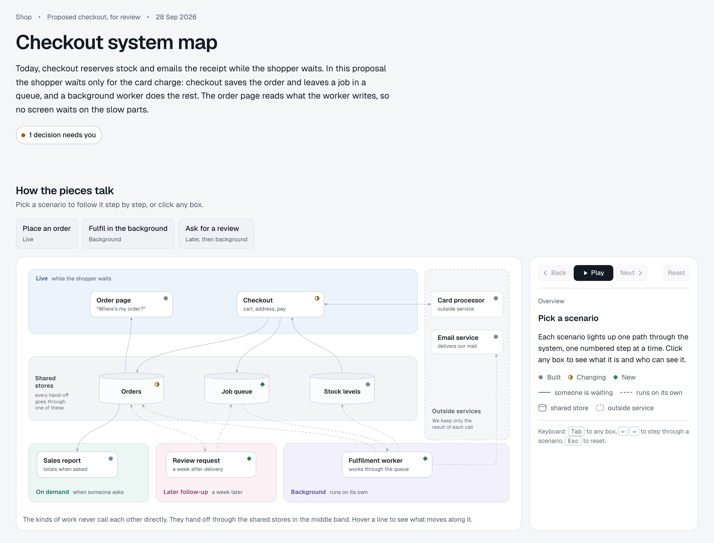
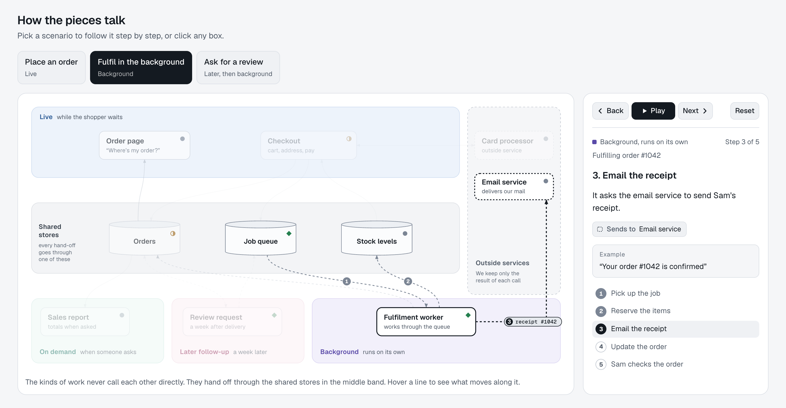
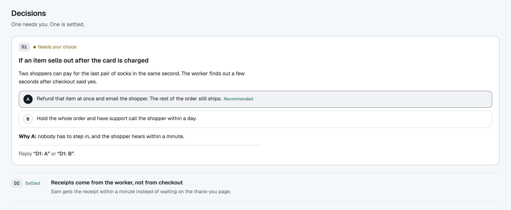
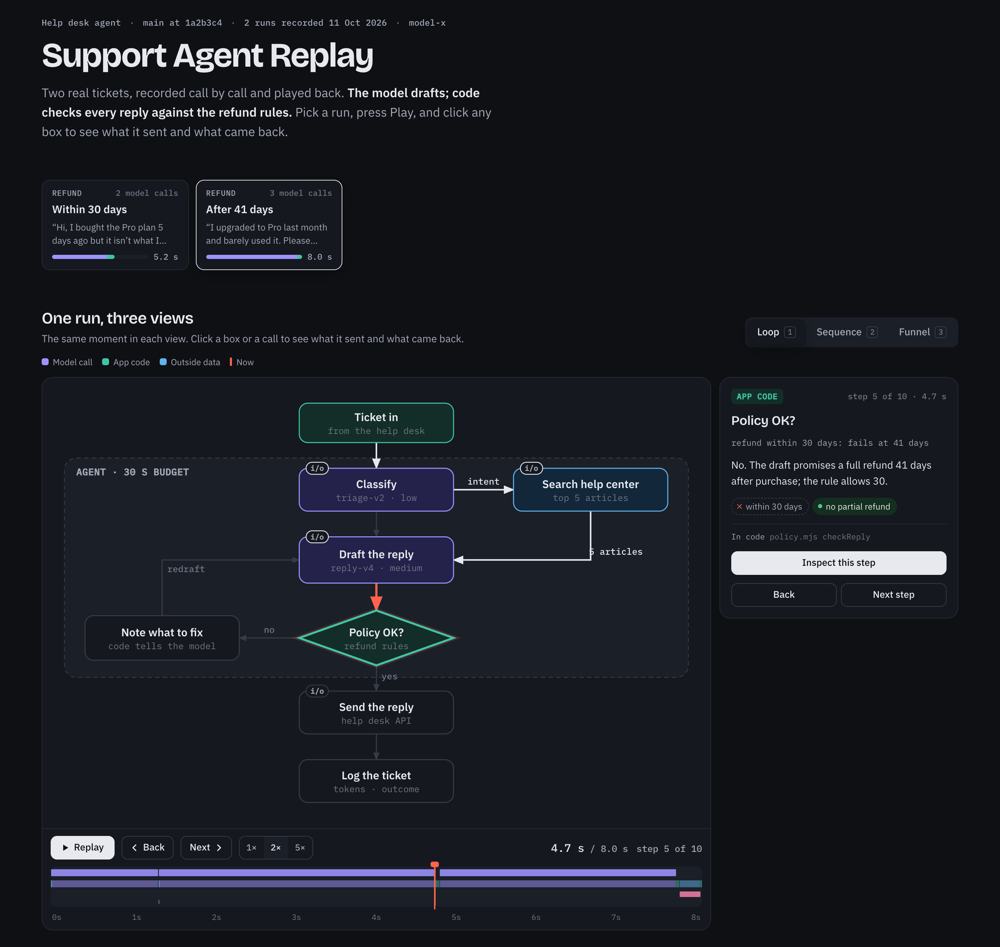
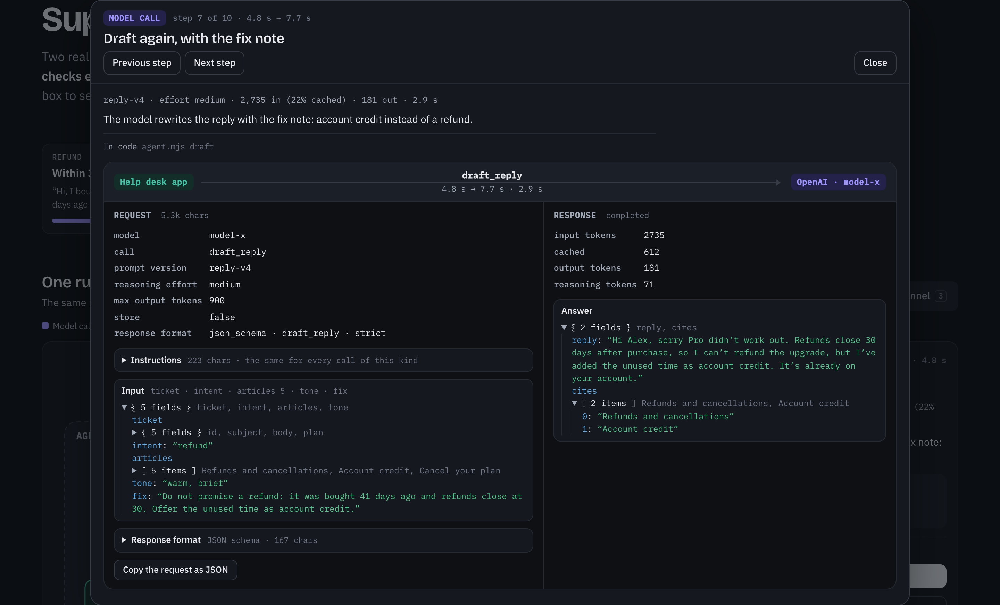
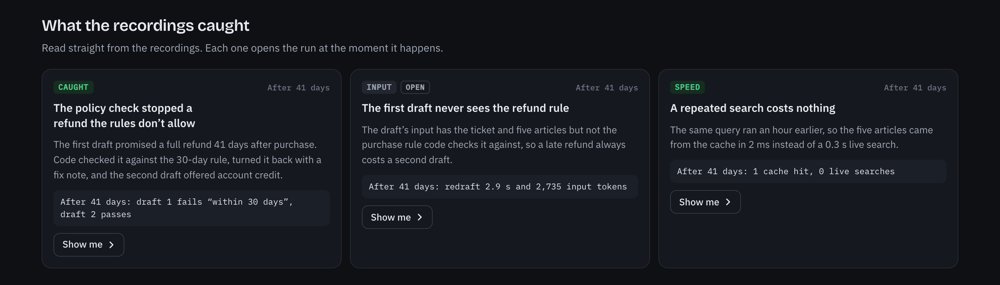

# Claude skills

Skills for Claude Code that turn a system into an interactive page people can review.

| Skill | What it builds | Use it when |
|---|---|---|
| [interactive-architecture-explainer](#interactive-architecture-explainer) | One diagram of how the parts of a system talk, with scenario buttons that play one path step by step, a plain-language side panel, and the decisions the reader needs to make | Someone who doesn't build the system needs to review its design, or compare the current and proposed design |
| [workflow-trace-replay](#workflow-trace-replay) | A replay of real recorded runs of an AI or agent workflow: the workflow as a state machine, every call on a timeline, a funnel, and a pop-up with exactly what each model call was sent and returned | You want to see how an LLM pipeline really behaves, debug it, or compare an old and a new version |

The screenshots below are the example pages that ship with each skill. Their data is made up.

## interactive-architecture-explainer

**The situation:** you plan to change how checkout works, and a product owner has to approve it. They won't read code or a sequence diagram. You ask Claude: "show me the architecture of this change for review".

**What you get:** one page. It opens with what changes and why, then the whole system on one map. Coloured bands show when each part runs: while the shopper waits, in the background, a week later, or when someone asks. Each box says whether it is built, changing or new.



**Pick a scenario and play it.** One path lights up, one numbered step at a time, and everything else fades. The side panel says what happens in plain words, with a concrete example: here, the background worker emails the receipt for order #1042.



**It ends with the decisions the reviewer has to make,** each with options, a recommendation and a one-line reason, so the review ends in a choice, not a meeting.



## workflow-trace-replay

**The situation:** your support agent sometimes writes a reply twice, and you don't know why. Logs show the calls but not what each one was sent. You ask Claude: "replay real runs of this agent".

**What you get:** Claude records real runs, every model call and API call with its full request and answer, and builds a page that plays them back. Pick a run and press Play. The workflow lights up as the run moves through it, and the timeline shows every call. Here, the run stops at the policy check: the first draft promised a refund 41 days after purchase, but the rule allows 30.



**Click any step to see exactly what was sent and what came back:** the model settings, the full input (here, the fix note the code added for the second draft), the answer and the tokens.



**Below the replay, Claude writes what the recordings show,** each finding with its evidence and a button that opens the run at that moment. Here: the first draft never sees the refund rule, so every late refund costs a second draft.



## Install

**As a plugin (Claude Code).** In Claude Code, add this repo as a marketplace, then install one skill or both:

```
/plugin marketplace add vspvikram/claude-skills
/plugin install interactive-architecture-explainer@vspvikram-skills
/plugin install workflow-trace-replay@vspvikram-skills
```

**Or copy the folder.** Copy a folder from `skills/` into `~/.claude/skills/`. Claude Code finds it the next time it starts.

Then ask for what you want, for example "show me the architecture of this service" or "replay real runs of this agent". You can also name the skill.

## What you need

- Claude Code.
- Node 22+ and Chrome or Chromium for each skill's `scripts/verify.mjs`, which checks the finished page in a headless browser. Set `CHROME=/path` if Chrome isn't found.
- Python 3 for `workflow-trace-replay`'s `build_runs.py` and `assemble.py`.

Recording real runs calls real models and costs tokens. The replay skill says to estimate the spend first, records no request headers and blanks key-like fields. Still read a recording before you share a page made from it: it holds your prompts and your test data.

## Layout

```
.claude-plugin/marketplace.json   the plugin list
skills/<name>/SKILL.md            what Claude reads: when to use the skill and how
skills/<name>/template/           a working page with made-up data to copy
skills/<name>/scripts/            the helpers and the page checker
skills/<name>/reference/          worked examples and research notes
docs/screenshots/                 the images in this README
```

To add a skill, add its folder under `skills/` and an entry to `.claude-plugin/marketplace.json`, then run `claude plugin validate .`.

## License

[MIT](LICENSE)
